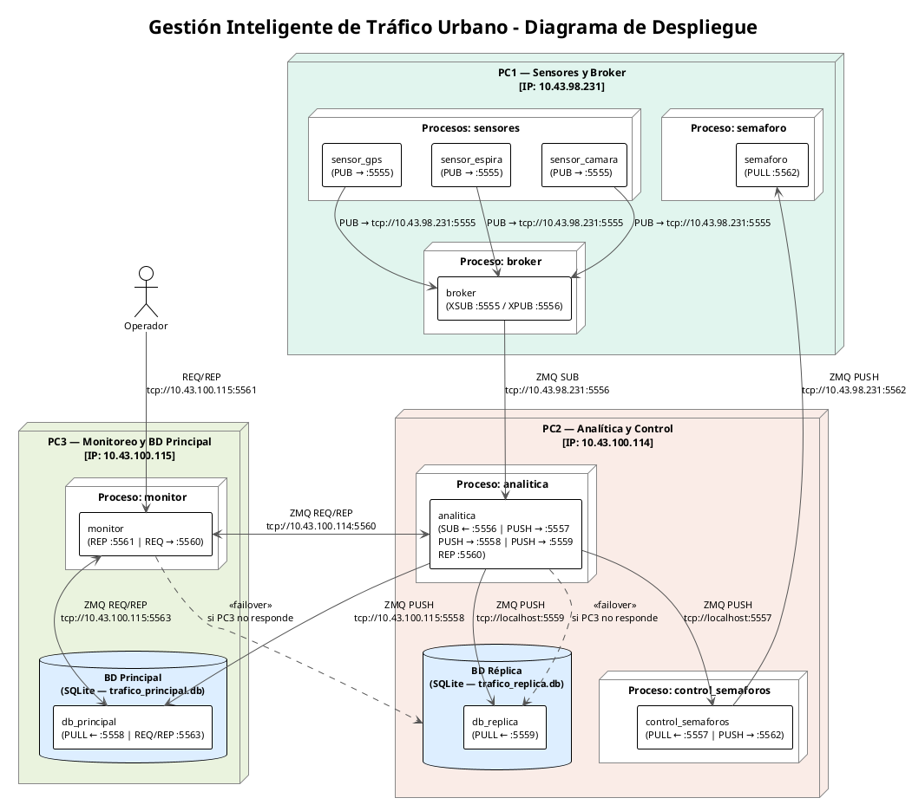

## Diagrama de Despliegue

### Tabla de Puertos ZMQ

| Puerto | Protocolo | Origen | Destino |
|--------|-----------|--------|---------|
| `5555` | PUB/XSUB  | Sensores (PC1) | Broker XSUB (PC1) |
| `5556` | XPUB/SUB  | Broker XPUB (PC1) | Analítica SUB (PC2) |
| `5557` | PUSH/PULL | Analítica (PC2) | Control Semáforos (PC2) |
| `5558` | PUSH/PULL | Analítica (PC2) | BD Principal (PC3) |
| `5559` | PUSH/PULL | Analítica (PC2) | BD Réplica (PC2) |
| `5560` | REQ/REP   | Monitor (PC3) ↔ Analítica (PC2) | bidireccional |
| `5561` | REQ/REP   | Operador ↔ Monitor (PC3) | bidireccional |
| `5562` | PUSH/PULL | Control Semáforos (PC2) | Semáforos (PC1) |
| `5563` | REQ/REP   | Monitor (PC3) ↔ BD Principal (PC3) | bidireccional |
| `5564` | REQ/REP   | Monitor (PC3) ↔ BD Réplica (PC2) | solo en failover |

### Artefactos por Nodo

| Nodo | Ejecutable | Compilación |
|------|-----------|-------------|
| PC1  | `broker`, `sensor_espira`, `sensor_camara`, `sensor_gps`, `semaforo` | `make pc1` |
| PC2  | `analitica`, `control_semaforos`, `db_replica` | `make pc2` |
| PC3  | `monitor`, `db_principal` | `make pc3` |